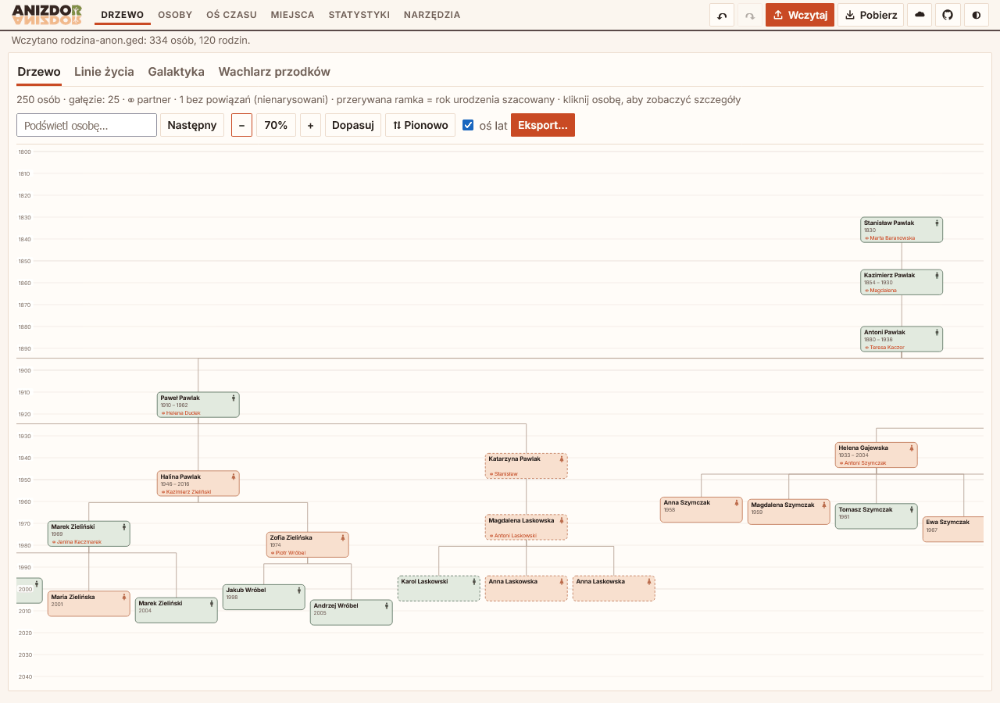
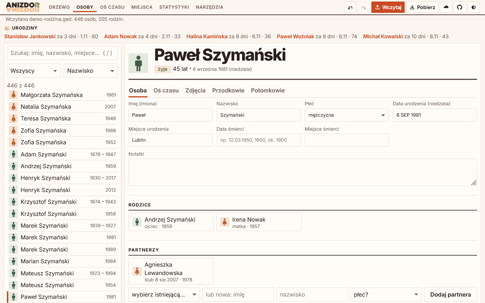
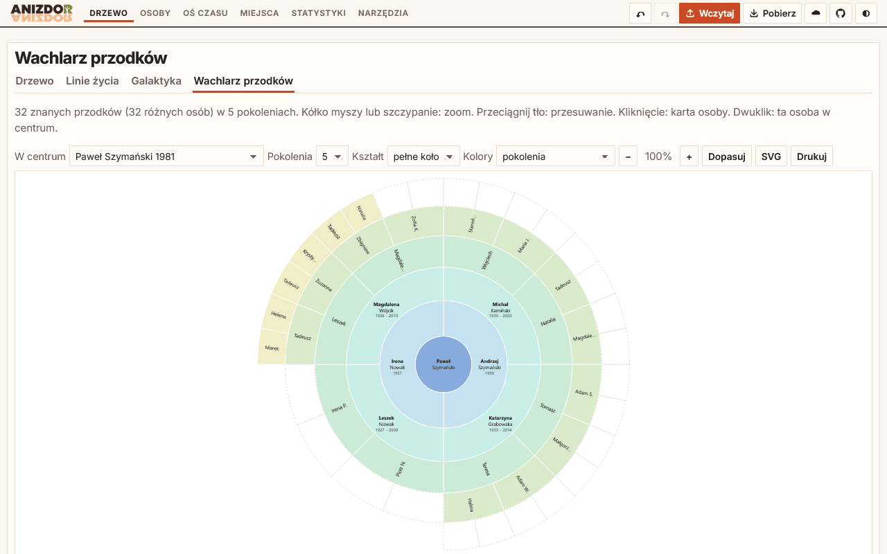
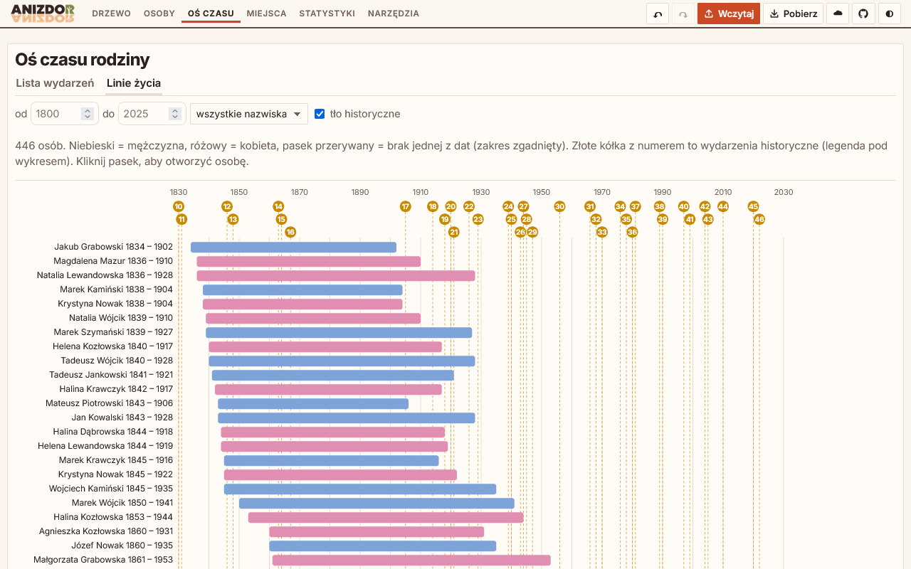
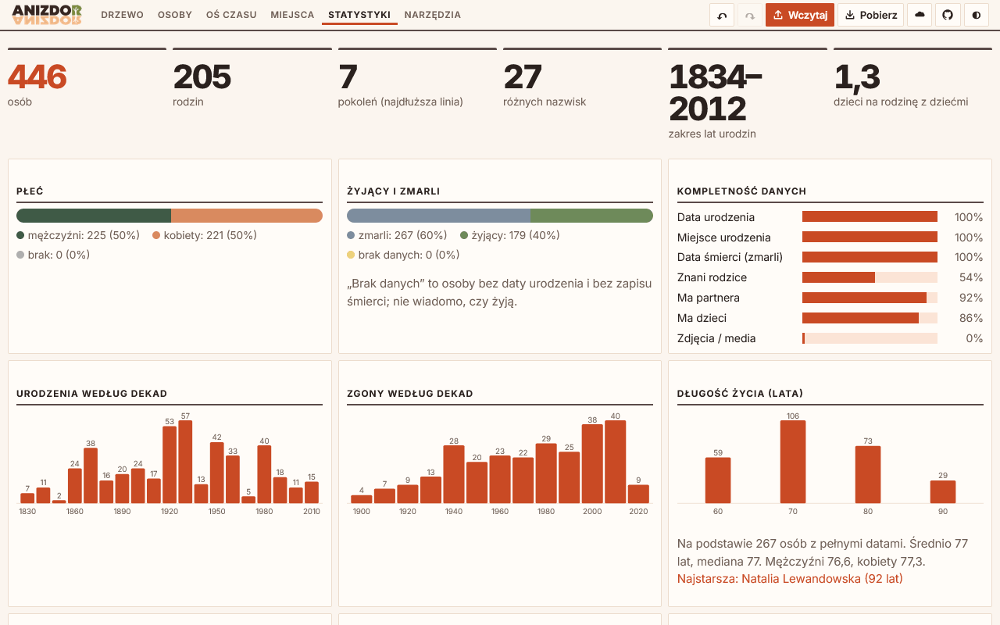
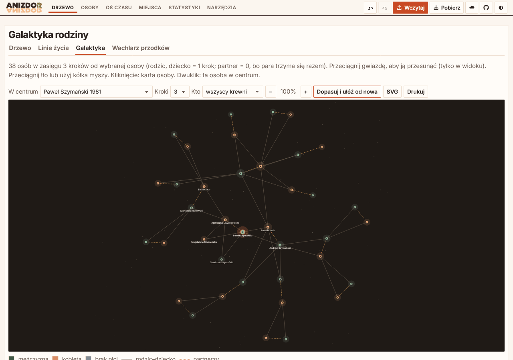
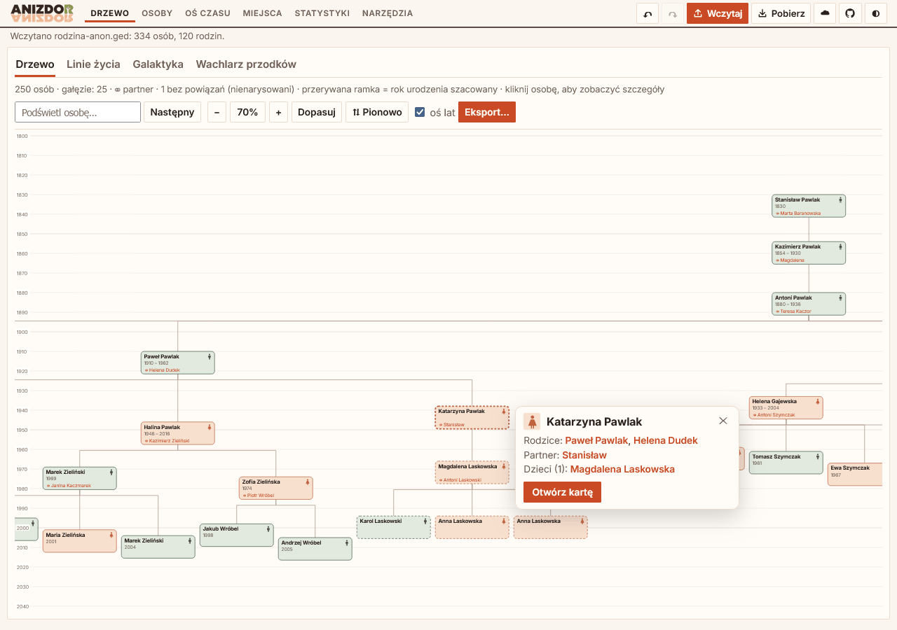

<picture>
  <source media="(prefers-color-scheme: dark)" srcset="public/logo-dark.png">
  
</picture>

### Free, open-source family tree editor that runs in your browser

No account. No install. No ads. Your family stays yours.

**[🌳 Open the app](https://anizdor.pages.dev/)** · [📂 GEDCOM](#-gedcom-compatibility) · [🔒 Privacy](#-privacy) · [🛠️ Development](DEVELOPMENT.md) · [📜 License](LICENSE)

 

Above: a real family of 334 people, anonymized (every name, date and place replaced, only the shape of the tree is real). Other screenshots use a made-up demo family. The app interface is in Polish.

## 👋 What is this?

ANIZDOR is a family tree editor for people who want to keep their genealogy **on their own device**. Open the page, load a GEDCOM file (the standard file format of genealogy programs), and start exploring or editing. Everything happens in your browser.

The name is **RODZINA** (Polish for "family") read backwards. The app interface is in **Polish** for now; translations are welcome (see [How to help](#-how-to-help)).

## ✨ What you can do

- 👤 **Edit people**: names, dates (type `12.03.1950` and it just works), places, events, notes, parents, partners, children. Undo and redo with Ctrl+Z / Ctrl+Y.
- 🌳 **See the tree your way**: the classic family board, a **vertical tree on a birth-year axis** where each box is as tall as that person's life (drag people sideways, relatives follow like on springs), a **galaxy** with one person in the centre and relatives around them, and an **ancestor fan** with up to 9 generations.
- 🖱️ **Click anyone in the tree** for a quick popup with the essentials, and fix names, dates and places right there.
- 📝 **Fill in the gaps**: a short form with the most important missing facts (birth years, surnames, places), handy when you sit down with grandma.
- ⏳ **Life lines and timeline**: bars from birth to death show **who lived at the same time**, with Polish and world history in the background.
- 📊 **Statistics**: surnames, given names, lifespans, births and deaths by decade, family size, generations, and more.
- 🩺 **Data checks with auto-repair**: impossible dates, parents younger than their children, duplicates (merge in one click), broken links. Safe problems can be fixed automatically.
- 📍 **Places and sources**: rename a place everywhere at once, add coordinates, keep sources and research tasks.
- 🖼️ **Photos**: stored in your browser, shrunk to a sensible size, with a primary photo as the avatar.
- 💾 **Backup**: one ZIP with your GEDCOM and all photos.
- 🖨️ **Export to PNG, PDF or SVG**: arrange the people the way you want them **by dragging, before you save**.

<table>
  <tr>
    <td width="50%"> <b>People</b>: search, filters, and a full person card</td>
    <td width="50%"> <b>Ancestor fan</b>: gaps show as dashed, never as invented people</td>
  </tr>
  <tr>
    <td width="50%"> <b>Life lines</b>: see who overlapped in time</td>
    <td width="50%"> <b>Statistics</b>: your family in numbers</td>
  </tr>
  <tr>
    <td width="50%"> <b>Galaxy</b>: one person in the centre, relatives around them</td>
    <td width="50%"> <b>Click anyone</b>: parents, partners and children at a glance</td>
  </tr>
</table>

## 🔒 Privacy

- **Your data stays in your browser** (local storage and IndexedDB). The app loads no third-party scripts and nothing leaves your device unless you turn the cloud on.
- **Optional family cloud**, end-to-end encrypted. Relatives who know the family password share one tree and its photos on Cloudflare. Your password becomes a key with **PBKDF2 (600,000 rounds)** and the data is sealed with **AES-GCM** in your browser before upload. The server only ever sees ciphertext, so nobody else can read your tree, and a forgotten password cannot be recovered.
- Want to share a tree without living relatives in it? There is an **anonymised export** that leaves living people out.

## 📂 GEDCOM compatibility

GEDCOM is the common language of genealogy software, so you can move in and out freely.

- **Import**: UTF-8, UTF-16, and legacy ANSI files (Windows-1250 and 1252, so Polish letters survive).
- **Export**: GEDCOM 5.5.1, UTF-8. Data the editor does not touch (media, burial, custom tags, extra names) comes back **unchanged**.
- Works with files from programs such as **Ahnenblatt** and **MyHeritage**. The ZIP backup also carries a standards-only GEDCOM for them.
- Other exports: CSV for Excel.

## 📱 Works offline, looks good in the dark

ANIZDOR is an installable **PWA**: add it to your phone or desktop and it keeps working without internet. There is a **dark mode** for late-night research, and keyboard shortcuts (press `/` to search) for the impatient.

## 🚀 Run your own copy

It is a plain static site plus one small Cloudflare function, so your own copy is cheap and quick:

1. **Fork** this repository.
2. Connect the fork to **Cloudflare Pages** (output folder `public`, no build command) or use the included GitHub Actions workflow.
3. Optional: add a D1 database if you want the encrypted family cloud.

Step-by-step details, the cloud API, tests, and tooling are in **[DEVELOPMENT.md](DEVELOPMENT.md)**.

## 🤝 How to help

ANIZDOR gets better when real family trees run into it. You can:

- 🐛 **Report a bug** or 💡 **suggest an idea** in [GitHub Issues](https://github.com/itstomekk/anizdor/issues).
- 🌍 **Help translate** the interface. It is Polish only today, and every language opens the app to more families.
- 🧪 **Test with your own GEDCOM files** from other programs and tell us what breaks.
- ⚠️ **Never post real family data in issues.** Names, dates, and photos of living people are private. Trim or invent a small example that shows the problem.

## 📜 License

[MIT](LICENSE) © 2026 Tomek Kołodziejczuk. Free to use, copy, change, and share.
